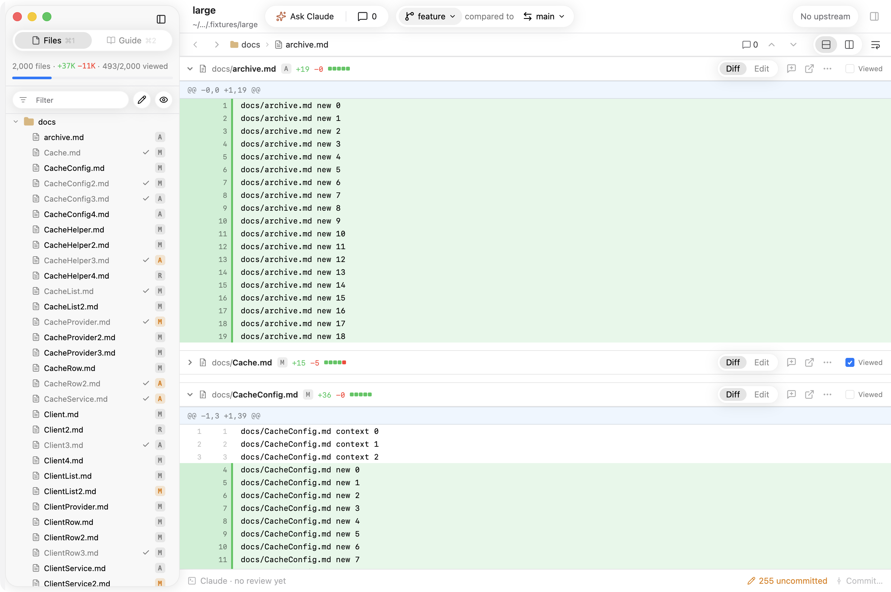

# diffpilot

diffpilot is a macOS app for reviewing Git changes before you push them. It shows a branch compared to its base, keeps track of the files you have viewed, and lets Claude review the change and answer your comments. It is written in Rust with [GPUI](https://www.gpui.rs).



## Requirements

- macOS 13 or later, Apple Silicon or Intel.
- Git. Install the Xcode command line tools if you don't have it: `xcode-select --install`.
- Rust, from [rustup](https://rustup.rs): `curl --proto '=https' --tlsv1.2 -sSf https://sh.rustup.rs | sh`
- Optional, for the Claude features: [Claude Code](https://docs.claude.com/en/docs/claude-code), signed in. diffpilot runs the `claude` command on your Mac. It needs no API key.

You don't need Xcode or its Metal toolchain. diffpilot compiles its GPU shaders when it starts.

## Install

```sh
git clone https://github.com/adamward459/diffpilot.git
cd diffpilot
scripts/install.sh
```

The script does three things:

1. It builds a release binary. The first build takes a few minutes.
2. It puts `diffpilot.app` in `/Applications`, or in `~/Applications` if `/Applications` is not writable.
3. It adds a `diffpilot` command in `~/.local/bin`. If that folder is not on your `PATH`, the script tells you the line to add to `~/.zshrc`.

Options:

| Option | What it does |
| --- | --- |
| `--dest DIR` | Install the app into `DIR` |
| `--no-cli` | Skip the `diffpilot` command |
| `--uninstall` | Remove the app and the command |

To update, pull the latest code and run `scripts/install.sh` again.

## Run

- Open **diffpilot** from Applications or Spotlight, then press ⌘O and pick a Git repository.
- From a terminal, run `diffpilot` inside a repository, or `diffpilot path/to/repo`. Any folder inside the repository works.
- Without installing, run `cargo run --release -p diffpilot -- path/to/repo` from this folder.

diffpilot opens the last repository you used. It reloads by itself when files or branches change.

## Use it

- **Pick what to compare.** The toolbar has two menus. The first picks the branch, and the second picks the base it is compared to. The base can be a branch, a tag, a recent commit, only the working tree, or only the staged changes.
- **Track your progress.** Check **Viewed** on a file to collapse it. diffpilot remembers viewed files per repository and branch. It clears the mark when the file changes again.
- **Find files.** The sidebar shows the changed files as a tree or a list. Filter by name, show only uncommitted files, or hide viewed files.
- **Comment.** Hover a line and click `+` to start a thread. Type `@claude` in a comment to get a reply from Claude.
- **Review with Claude.** Click **Ask Claude** to run a review. You can pick focus areas, add instructions, and choose the model. Findings appear as threads on the lines they talk about. Press ⌘. to stop a review.

| Shortcut | Action |
| --- | --- |
| ⌘O | Open a repository |
| ⌃⌘S | Show or hide the sidebar |
| ⌘. | Stop the Claude review |
| ⌘↩ | Post a comment |
| ↑ ↓ ← → | Move through the sidebar |

## Where data lives

Settings and viewed files are in `~/Library/Application Support/diffpilot/`: `settings.json` and `viewed.json`. Delete that folder to reset diffpilot. diffpilot never writes into your repository's `.git` folder.

## Develop

The Cargo workspace has three crates:

| Crate | Holds |
| --- | --- |
| `core` | Git, comparisons, the diff parser, viewed files, settings, the file watcher, and the Claude runner. No UI. |
| `ui-kit` | The theme, the icons, and the shared components (buttons, glass capsules, badges). `cargo run -p diffpilot-ui-kit --example gallery` shows them. |
| `gpui-app` | The `diffpilot` binary: window, sidebar, and comparison menus. Its library holds the diff view (`src/diff_pane/`) and the Claude review pill, popover, and thread cards (`src/review/`). |

Common commands:

```sh
git config core.hooksPath .githooks   # once per clone: format Rust and Python on commit
cargo run -p diffpilot                # debug build
scripts/test.py related               # print the tests and checks for your change
scripts/test.py unit                  # run all tests
scripts/test.py hotpath               # compare frame-time benchmarks with the base branch
scripts/test.py screenshot            # capture the app in light and dark
```

These environment variables help with testing:

| Variable | Effect |
| --- | --- |
| `DIFFPILOT_REPO=path` | Open this repository |
| `DIFFPILOT_APPEARANCE=light` or `dark` | Force the appearance |
| `DIFFPILOT_REVIEWER=scripted` | Use a fake Claude reviewer with a fixed result |
| `DIFFPILOT_VIEWED_SEED=file.json` | Start with these files marked viewed, kept in memory |
| `DIFFPILOT_BENCH=1` | Run a benchmark, print JSON, and quit |

`scripts/fixture_repo.py` builds `.fixtures/large`, a test repository with about 2000 changed files. The benchmarks and screenshots use it.
